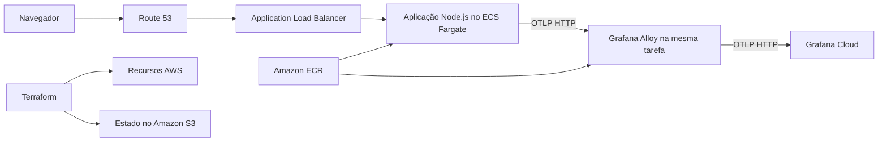

# Infraestrutura de observabilidade

Infraestrutura do projeto acadêmico de observabilidade de uma aplicação web. Este repositório define, com Terraform, os recursos da AWS que executam a aplicação Node.js e encaminham sua telemetria ao Grafana Cloud. O código da aplicação está no repositório [devops-observabilidade](https://github.com/jessnascimento/devops-observabilidade).

## Arquitetura



O ECS executa a aplicação e o Alloy em containers na mesma tarefa Fargate. A aplicação usa instrumentação automática do OpenTelemetry e envia telemetria para o Alloy em `localhost:4318`. O Alloy recebe métricas, logs e traces via OTLP, processa os dados em lotes e os encaminha ao Grafana Cloud. A disponibilidade de cada sinal depende da instrumentação e da configuração dos serviços de destino; mensagens de console, por si só, não garantem exportação de logs.

O ALB encaminha requisições HTTP à aplicação na porta 3000, e o Route 53 fornece o nome de domínio. Um certificado ACM é solicitado com validação DNS; o listener HTTPS é habilitado separadamente. O HTTP permanece disponível sem redirecionamento quando HTTPS está ativo.

## Tecnologias

| Tecnologia | Finalidade |
| --- | --- |
| Terraform | Provisionamento e gerenciamento da infraestrutura |
| Amazon ECS Fargate e ECR | Execução dos containers e armazenamento das imagens |
| Application Load Balancer, Route 53 e ACM | Acesso à aplicação, DNS e certificado TLS |
| Amazon S3 | Estado remoto do Terraform, com bloqueio por arquivo |
| AWS Secrets Manager e IAM | Credenciais do Grafana Cloud e permissões |
| Grafana Alloy e Grafana Cloud | Encaminhamento e análise de telemetria |
| GitHub Actions | Execução manual do Terraform e publicação da imagem Alloy |

## Estrutura

```text
terraform/          Recursos AWS, variáveis, outputs e teste Terraform
alloy/              Dockerfile e configuração do Grafana Alloy
.github/workflows/  Workflow de infraestrutura
```

## Pré-requisitos

- Conta AWS, AWS CLI autenticada, Docker e Terraform 1.10 ou posterior.
- VPC padrão com sub-redes adequadas ao ALB e ao ECS, zona pública no Route 53 e domínio delegado a essa zona.
- Repositórios ECR e imagens da aplicação e do Alloy disponíveis antes de iniciar a tarefa. O workflow da aplicação publica a imagem da aplicação; o workflow deste repositório publica a imagem do Alloy ao aplicar.
- Segredo no Secrets Manager contendo a chave JSON `GRAFANA_CLOUD_AUTHORIZATION`, com o valor de autorização fornecido pelo Grafana Cloud. O endpoint OTLP do Alloy está definido na task definition e deve corresponder à instância usada.
- Role de execução da tarefa e role para o GitHub Actions com as permissões necessárias. A task role em `terraform/ecs.tf` está vinculada a uma conta específica e precisa existir ou ser adaptada para outra conta.

## Estado remoto e configuração

O backend usa um bucket S3 preexistente na região `us-east-1`, a chave `projeto-observabilidade/terraform.tfstate` e um arquivo de bloqueio. Crie o bucket fora desta configuração, bloqueie o acesso público e habilite versionamento e criptografia. Conceda ao operador e à role do workflow acesso ao estado e ao arquivo `.tflock`. O estado pode conter dados sensíveis.

Configure as variáveis obrigatórias e inicialize o Terraform:

```bash
export TF_STATE_BUCKET="nome-unico-do-bucket"
export TF_VAR_hosted_zone_id="ID_DA_ZONA_PUBLICA"
export TF_VAR_app_hostname="app.exemplo.com"
export TF_VAR_grafana_secret_arn="ARN_DO_SEGREDO"
cd terraform
terraform init -backend-config="bucket=$TF_STATE_BUCKET"
terraform validate
terraform plan -out=tfplan
```

Revise o plano antes de executar `terraform apply tfplan`. Se a infraestrutura já existir, importe os recursos para o estado antes de aplicar; confira primeiro se o bucket já contém um estado válido. Não execute importações e workflows simultaneamente. O arquivo de plano também pode conter dados sensíveis.

O health check do ALB usa `/` e aceita HTTP 200–399 por padrão. Ajuste `health_check_path` e `health_check_matcher` se a aplicação exigir outro endpoint ou código.

## Implantação pelo GitHub Actions

Configure as variáveis do repositório `AWS_ROLE_ARN`, `TF_STATE_BUCKET`, `ROUTE53_HOSTED_ZONE_ID`, `APP_HOSTNAME` e `TF_VAR_grafana_secret_arn`. `HEALTH_CHECK_PATH` é opcional. A role AWS deve confiar no provedor OIDC do GitHub e permitir as operações necessárias em S3, ECS, ECR, EC2, IAM, Secrets Manager, ELB, ACM e Route 53.

O workflow é iniciado manualmente. Primeiro execute com `apply=false` e revise o plano. Depois execute na branch `main` com `apply=true` e `enable_https=false` para disponibilizar HTTP e solicitar o certificado. Após o ACM emitir o certificado, revise um plano com `enable_https=true` e execute novamente com `apply=true`. Mantenha `enable_https=true` nas execuções seguintes para conservar o listener HTTPS. O plano de uma execução não é reutilizado pela seguinte.

## Observabilidade e custos

No Grafana Cloud, dashboards podem apresentar taxa de requisições, proporção de erros 5xx, proporção de sucesso e latência p95, conforme os sinais recebidos e as consultas configuradas. Este repositório não provisiona dashboards. A infraestrutura AWS, em particular o ALB e as tarefas Fargate, pode gerar custos; o Grafana Cloud está sujeito aos limites do plano contratado.

## Autores

Jessica, Felipe, Ravi Leal, Rayane Silva, Victor Oliveira e Victor Emery.
